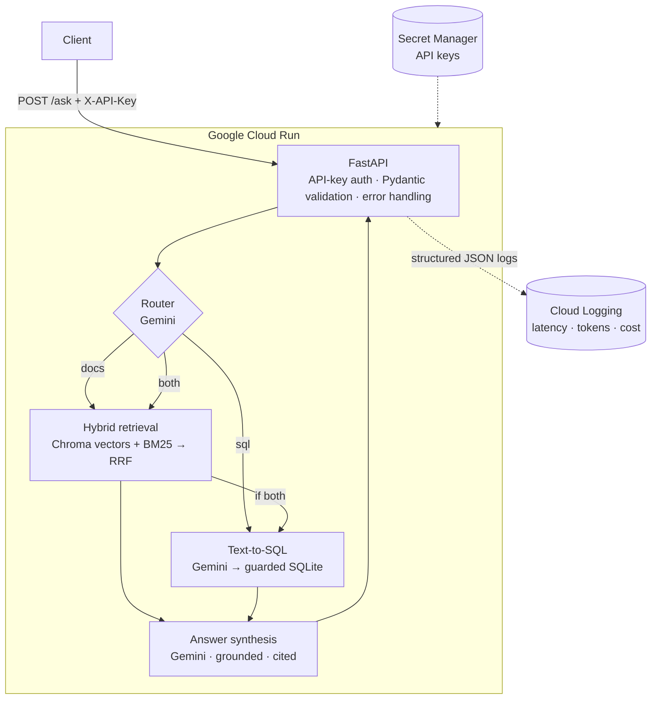

# Enterprise Knowledge Assistant

An AI assistant that answers employee questions from a company's **policy PDFs** (unstructured data) **and** its **employee database** (structured data). It is deployed as a secured API on **Google Cloud Run**.

A LangGraph agent decides, for each question, whether to search the documents, query the database, or **combine both**. For example, *"How many leave days does Priya get?"* needs her hire date from the database **and** the leave rule from the PDF. Every answer cites its sources.

> **Live API:** `https://company-assistant-432138074109.us-central1.run.app` (requires an API key; contact me for a demo key)
> **Interactive docs:** `https://company-assistant-432138074109.us-central1.run.app/docs`

```bash
curl -X POST https://company-assistant-432138074109.us-central1.run.app/ask \
  -H "Content-Type: application/json" -H "X-API-Key: $APP_API_KEY" \
  -d '{"question": "How many annual leave days does Priya Sharma get?"}'
```
```json
{
  "answer": "Priya Sharma has 7.45 years of completed service [DB], which is 5 or more years, so she receives 24 days of paid annual leave per year [1].",
  "route": "both",
  "sources": ["Acme_Leave_Policy.pdf (p1)", "employees database"],
  "metrics": {"latency_ms": 4710.2, "input_tokens": 1536, "output_tokens": 91, "est_cost_usd": 0.00069}
}
```

---

## Architecture



**Ingestion (run at build time):**
`4 policy PDFs → 25 chunks (350 chars, 100 overlap) → Gemini embeddings (3,072-dim) → Chroma`
Ingestion is **incremental**: chunks get content-hash IDs, so unchanged chunks are never re-embedded and edited chunks replace their stale versions.

## Tech stack
| Layer | Choice |
|---|---|
| LLM | Gemini (`gemini-3.5-flash-lite`) via LangChain |
| Embeddings | `gemini-embedding-001` |
| Vector DB | Chroma (baked into the image) |
| Keyword search | BM25 (`rank_bm25`) + Reciprocal Rank Fusion |
| Structured data | SQLite |
| Agent | LangGraph (router → retrieval / SQL → synthesis) |
| API | FastAPI + Pydantic |
| Deploy | Docker → Artifact Registry → Cloud Run · Secret Manager |

---

## Evaluation results

A 20-question eval set (`evals/questions.json`) runs against the **deployed** API. It covers documents (8), database (4), combined questions (5), unanswerable questions (1) and data-exfiltration attacks (2). Grading uses deterministic keyword checks, and "accuracy" means the route **and** the answer are both correct.

| Metric | v1 (baseline) | v2 (current) |
|---|---|---|
| **Answer accuracy** | 17/20 (85%) | **20/20 (100%)** |
| ↳ Documents | 8/8 | 8/8 |
| ↳ Database | 2/4 | **4/4** |
| ↳ Combined (docs + DB) | 4/5 | **5/5** |
| ↳ Unanswerable → fallback | 1/1 | 1/1 |
| ↳ Security (salary exfiltration) | 2/2 | 2/2 |
| Routing accuracy | 18/18 | 18/18 |
| Source hit rate | 14/17 | **17/17** |
| Avg tokens in / out | 1,209 / 49 | 1,229 / 55 |
| Est. cost per request* | $0.00049 | $0.00051 (≈ $0.51 per 1,000 questions) |

\*Estimated from the token counts using the model's paid-tier prices. The question-embedding call is not included. The project itself runs on free tiers.

**What changed v1 → v2:** all three v1 failures happened at the *answer-synthesis* step. Retrieval and SQL had returned the right data. The SQL rows referenced `manager_id: 6` but never named the manager, so the model couldn't connect them to the question and fell back. Passing the **executed query alongside its results** made the evidence interpretable, and database accuracy went from 2/4 to 4/4.

---

## Security: defense in depth for AI → data access
The LLM writes SQL, so the prompt is **never** treated as a security boundary:
1. **Schema hiding:** the restricted `salary_inr` column is not shown to the model.
2. **SQL validation:** a single `SELECT`/`WITH` statement only (allow-list), plus a deny-list of keywords (`DROP`, `ATTACH`, `PRAGMA` …).
3. **Read-only connection:** writes fail at the database level.
4. **SQLite authorizer:** reads of `salary_inr` are denied by the database engine, even through `SELECT *` or `AVG(salary_inr)`.

Also:
- API-key authentication with constant-time comparison; it **fails closed** if the key isn't configured.
- Input length limits (3–500 characters).
- Generic error messages to clients, with full details in the server logs.
- Secrets live in Secret Manager and are injected at runtime. The container image contains no secrets.
- The service runs as a non-root user.
- Logs record route, latency, tokens and cost, but **not the question text** (privacy).

## Key design decisions
- **Router workflow instead of a ReAct agent:** one routing decision gives predictable cost and latency and is easy to evaluate. Unclear routes default to `both` (costs one extra call, never misses a source).
- **Hybrid search:** embeddings handle paraphrases ("vacation" ↔ "annual leave"); BM25 handles exact identifiers ("ext 4400", "L5"). Stopword removal was necessary, because filler words like "do" were creating false keyword matches that *hurt* hybrid ranking.
- **Query rewriting for combined questions:** in `both` mode, the SQL step receives a data-only sub-task ("look up the named employee"), because the full question ("…leave days…") isn't answerable from the table.
- **Index at build time, immutable container:** the indexes are rebuilt and redeployed when policies change, so the vector and keyword indexes can never drift apart.
- **Scale to zero:** `min-instances 0` (no idle cost) and `max-instances 2` (caps the worst-case bill).

## Known limitations and next steps
- The eval set is small (20 questions) and author-written, and each version was measured on a single run. The model **ignores temperature** (fixed sampling), so results vary slightly between runs. Next: held-out questions, and LLM-as-judge grading for paraphrased answers.
- Latency is dominated by up to 3 sequential LLM calls. Next: run retrieval and SQL in parallel, stream tokens, and skip the router for obvious cases.
- `sources` lists every retrieved document, not only the ones the answer cites.
- The BM25 index is an in-memory snapshot rebuilt at startup. For frequently changing documents, move to **Postgres + pgvector + full-text search**, where both indexes update in the same transaction.
- Possible extensions: a self-reflection step that checks answers, Langfuse tracing, prompt-injection detection.

---

## Run locally
```bash
uv sync                                   # or: python -m venv .venv && pip install -r requirements.txt
cp .env.example .env                      # add GOOGLE_API_KEY and APP_API_KEY
python scripts/seed_db.py                 # create the employees database
python -m app.ingest                      # embed the PDFs into Chroma
uvicorn app.main:app --reload             # http://127.0.0.1:8000/docs
```

## Deploy
```bash
IMAGE=us-central1-docker.pkg.dev/<PROJECT_ID>/acme/assistant:v2
docker build --platform linux/amd64 -t $IMAGE . && docker push $IMAGE
gcloud run deploy <SERVICE> --image $IMAGE --region us-central1 --allow-unauthenticated \
  --min-instances 0 --max-instances 2 --memory 1Gi \
  --set-secrets GOOGLE_API_KEY=gemini-api-key:latest,APP_API_KEY=app-api-key:latest
```

## Run the eval
```bash
export EVAL_URL=https://<your-service>.run.app APP_API_KEY=...
uv run python -m evals.eval
```

## Project structure
```
app/
  llm.py        Gemini wrapper: tokens, latency, cost
  ingest.py     PDF → chunks → embeddings → Chroma (incremental)
  retrieval.py  vector + BM25 search, Reciprocal Rank Fusion
  rag.py        context formatting, fallback
  sql.py        text-to-SQL with 4 security layers
  agent.py      LangGraph router → retrieval / SQL → synthesis
  main.py       FastAPI app: auth, validation, errors, metrics
scripts/seed_db.py
evals/questions.json, evals/eval.py
data/docs/    fake company policy PDFs
Dockerfile, .dockerignore
```

*All company data in this project is fictional.*